**Repositorio:** https://github.com/sebaagonzalezc/contentflow-mongodb

# 1. Objetivos del proyecto

**Objetivo general.** Implementar en MongoDB Atlas (cluster gratuito M0) la base de datos de
ContentFlow a partir de los cinco archivos JSON del Anexo, desarrollar consultas y operaciones
CRUD que respondan a las necesidades de la gerencia, e integrarla con una API REST propia que
lea y escriba en tiempo real, con control de errores y trazabilidad.

**Objetivos específicos**

1. Configurar un cluster M0 seguro: usuario con privilegio mínimo (`readWrite` solo sobre
   `contentflow`), acceso de red restringido a IPs conocidas y consistencia definida
   (read concern y write concern).
2. Cargar las cinco colecciones (`usuarios`, `publicaciones`, `reacciones`, `comentarios`,
   `campanas`), verificar la cantidad de documentos y convertir las fechas de texto a `Date`.
3. Detectar, documentar y tratar las inconsistencias del conjunto de datos sin eliminar
   registros sin dejar evidencia.
4. Responder con consultas y agregaciones a cuatro preguntas de negocio: **diseño de contenido,
   horarios de publicación, perfil de audiencia y éxito de las campañas**, e identificar a los
   usuarios más activos y los contenidos más populares.
5. Optimizar con índices (el sharding no está disponible en M0) y medir su efecto con
   `explain("executionStats")`.
6. Exponer la base mediante una API REST (Python + FastAPI + pymongo) con validación de
   entradas, códigos HTTP adecuados, logs de actividad y prueba de conectividad.

# 2. Configuración de la base de datos en MongoDB Atlas

La configuración se hizo con **Atlas CLI** para que quedara como script reproducible
(`scripts/00_atlas_setup.ps1`) y se completó y verificó en la interfaz web.

## 2.1 Cluster M0

| Parámetro | Valor | Justificación |
|---|---|---|
| Proyecto | `ContentFlow` (dedicado) | Atlas permite un solo cluster Free por proyecto; aísla el encargo |
| Nombre del cluster | `ContentFlowCluster` | Descriptivo; no se puede cambiar después |
| Tier | Free (M0) | Requisito del encargo, sin costo |
| Proveedor | AWS | Disponible para M0 y región cercana |
| Región | São Paulo `sa-east-1` | Región más cercana a Santiago: menor latencia para la API |
| Versión | MongoDB 8.0.37 | Versión que Atlas usa para clusters Free |
| Topología | Replica set de 3 nodos | Fijo en M0; da alta disponibilidad y permite `w: "majority"` |

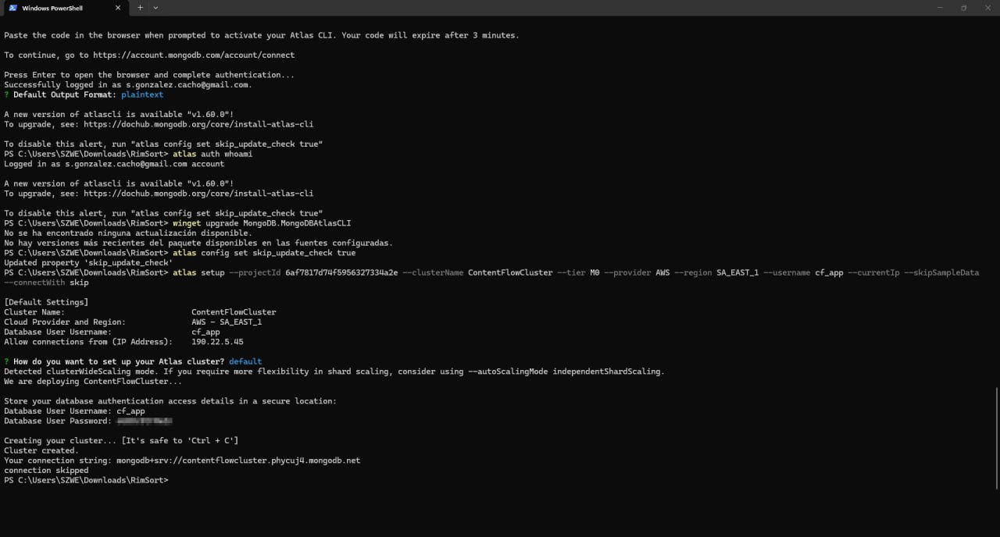

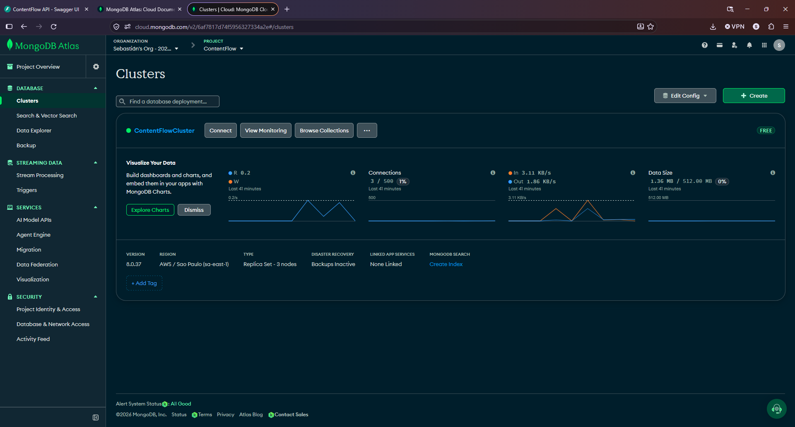

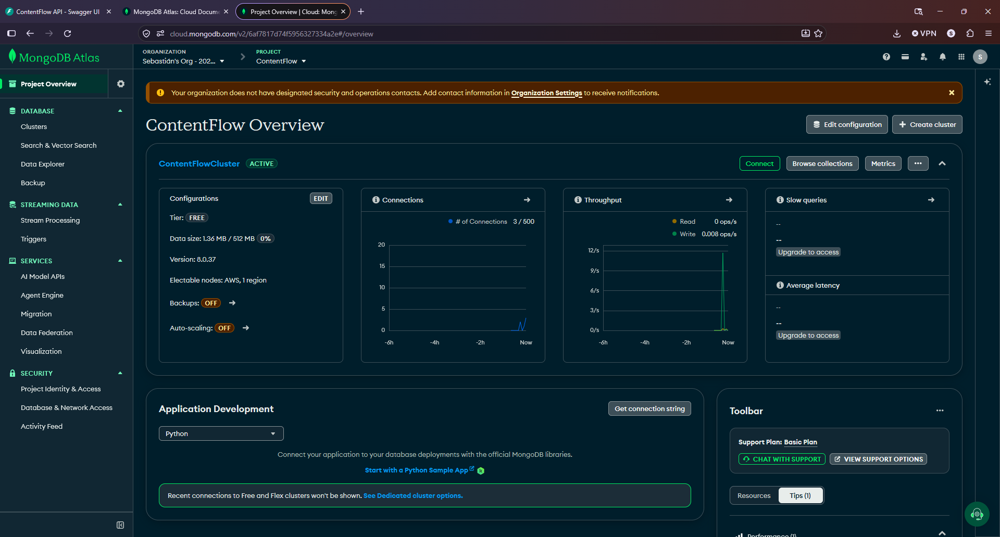

## 2.2 Base de datos y colecciones

Base de datos: **`contentflow`**. Colecciones: `usuarios`, `publicaciones`, `reacciones`,
`comentarios` y `campanas`. Esta última se nombró sin ñ, como pide el caso. Los `_id` se
mantienen como texto (`user_1`, `pub_1`, etc.).

Colecciones de apoyo creadas por el proceso de calidad: `auditoria_calidad` (registro de
hallazgos) y `reacciones_descartadas` (duplicado retirado con su motivo).

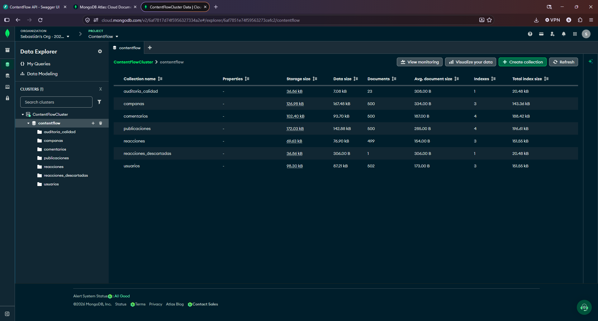

## 2.3 Usuario de base de datos y Network Access

- **Usuario `cf_app`** con rol **`readWrite@contentflow`**: puede leer, escribir y crear
  índices solo en la base del proyecto. No tiene privilegios de administración ni acceso a
  otras bases (principio de mínimo privilegio). La contraseña se guarda en un gestor de
  contraseñas y nunca en el repositorio.
- **Network Access:** solo la IP pública del equipo de desarrollo (`/32`). Se descartó
  `0.0.0.0/0` porque abriría el cluster a cualquier dirección de internet, y la seguridad
  quedaría dependiendo solo de la contraseña. Su único uso razonable sería un despliegue con
  IP dinámica o desconocida (por ejemplo, un PaaS sin IP fija), y aun así sería temporal.

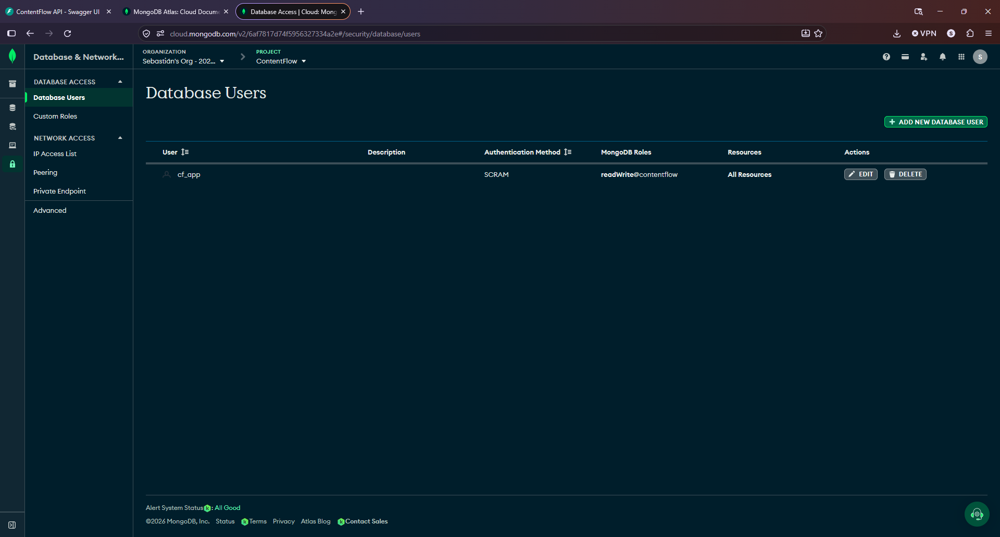

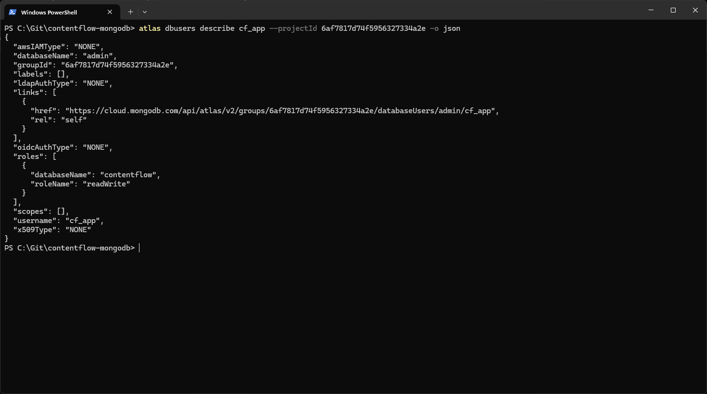

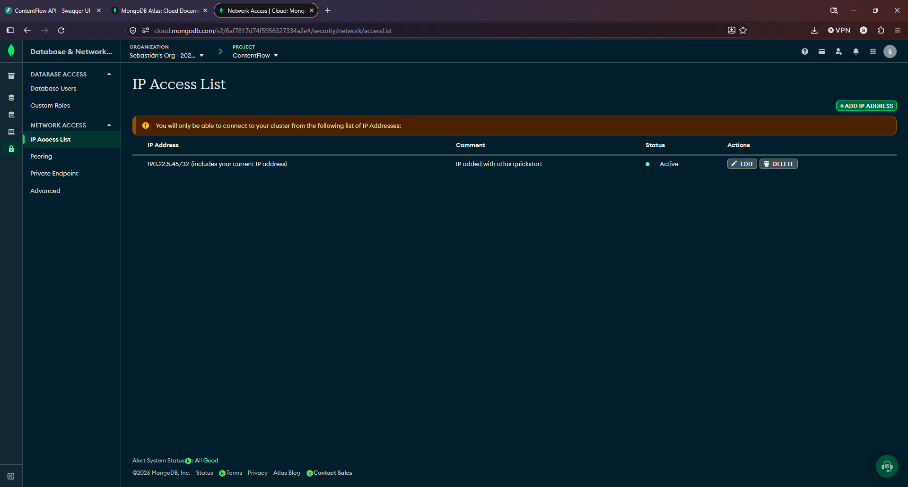

## 2.4 Índices y justificación

En M0 no existe particionamiento (sharding), así que los índices son el mecanismo de
optimización. Cada índice responde a una consulta del proyecto (`scripts/05_indices.js`):

| Colección | Índice | Consulta que atiende |
|---|---|---|
| usuarios | `{correo: 1}` **único** | Búsqueda por correo; impide registrar dos veces el mismo correo (409 en la API) |
| usuarios | `{pais: 1, dispositivo: 1}` | Perfil de audiencia por país y dispositivo |
| publicaciones | `{usuario_id: 1, fecha_publicacion: -1}` | Publicaciones de un usuario, recientes primero |
| publicaciones | `{categoria: 1, fecha_publicacion: -1}` | Filtro por categoría + rango de fechas + orden (regla ESR) |
| publicaciones | `{hashtags: 1}` (multikey) | Búsqueda por hashtag dentro del arreglo |
| reacciones | `{publicacion_id: 1, tipo_reaccion: 1}` | `$lookup` desde publicaciones y conteo por tipo |
| reacciones | `{usuario_id: 1, publicacion_id: 1}` **único** | Regla de negocio: una reacción por usuario y publicación |
| comentarios | `{publicacion_id: 1, fecha: -1}` | Comentarios de una publicación, recientes primero |
| comentarios | `{usuario_id: 1}` | Actividad por usuario |
| comentarios | `{likes: -1}` | Ranking de comentarios |
| campanas | `{fecha_inicio: 1, fecha_fin: 1}` | Campañas vigentes en una fecha |
| campanas | `{publicaciones_asociadas: 1}` (multikey) | Campañas en que participa una publicación |

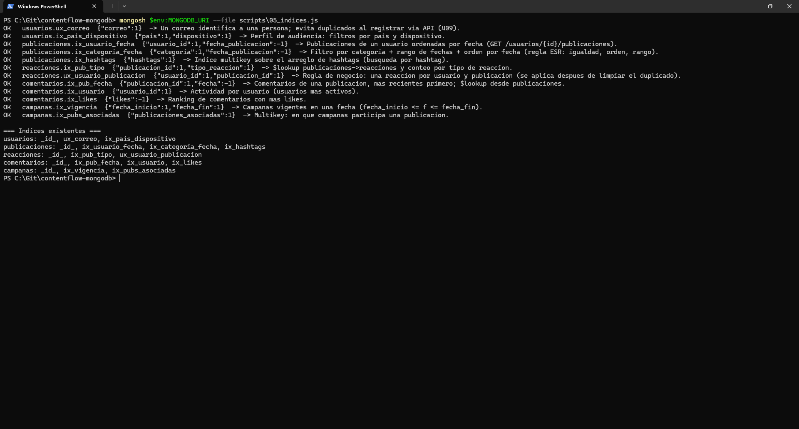

## 2.5 Límites del tier M0 y su impacto

Fuente: documentación oficial *Atlas Free Cluster Limits*.

| Límite M0 | Valor | Impacto en ContentFlow |
|---|---|---|
| Almacenamiento | 0,5 GB | El dataset ocupa 1,36 MB de 512 MB (0 % según Atlas): margen amplio. Con miles de interacciones diarias habría que escalar |
| Conexiones | máx. 500 | La API usa un único `MongoClient` con pool, compartido por todas las peticiones |
| Throughput | 100 operaciones/s | Atlas frena el exceso. La API pagina (`limit` ≤ 100) y valida referencias con `count_documents(limit=1)` |
| Transferencia | 10 GB de entrada y 10 GB de salida cada 7 días | Suficiente para pruebas; se evitan respuestas masivas |
| Ordenamiento en memoria | 32 MB, sin `allowDiskUse` | Los ordenamientos se apoyan en índices; las agregaciones usan `$limit` |
| Agregación | máx. 50 etapas por pipeline | Los pipelines del proyecto usan menos de 12 |
| Bases y colecciones | 100 bases y 500 colecciones | Se usa 1 base y 7 colecciones |
| JavaScript del servidor | No soportado (`$where`, map-reduce) | No se usa; todo es con operadores de agregación |
| Sharding | No disponible | Se optimiza con índices |
| Inactividad | Pausa tras 30 días sin conexiones | Riesgo para una demo futura; reactivar antes de usar |

## 2.6 Nivel de consistencia: read concern y write concern

- **Write concern `majority` + `journal: true`:** una escritura se confirma cuando la mayoría
  de los 3 nodos la tiene en disco. Si cae el primario, la escritura no se pierde por rollback.
  Es el valor por defecto en MongoDB 5.0 y posteriores (verificado con
  `db.adminCommand({getDefaultRWConcern: 1})`), pero la API lo fija explícitamente en el
  `MongoClient`.
- **Read concern `majority` en la API:** solo se devuelven datos confirmados por la mayoría, así
  la aplicación nunca muestra algo que pueda revertirse. El costo es una latencia algo mayor que
  con `local` (el valor por defecto de lectura), aceptable para una plataforma de contenido.
- Los scripts de mongosh usan los valores por defecto del cluster: `local` para lectura y
  `majority` para escritura.

## 2.7 Verificación de conectividad

1. **Atlas Data Explorer:** colecciones visibles con sus documentos (figura de la sección 2.2).
2. **mongosh:** `db.runCommand({ping: 1})` devuelve `{ ok: 1 }`.
3. **Driver pymongo (API):** al iniciar registra `Conexion a MongoDB OK`, y `GET /health` devuelve `{"status": "ok", "ping_ms": 55.2}`.
4. **mongoimport y Atlas CLI:** la importación y la administración del cluster también se conectaron correctamente.

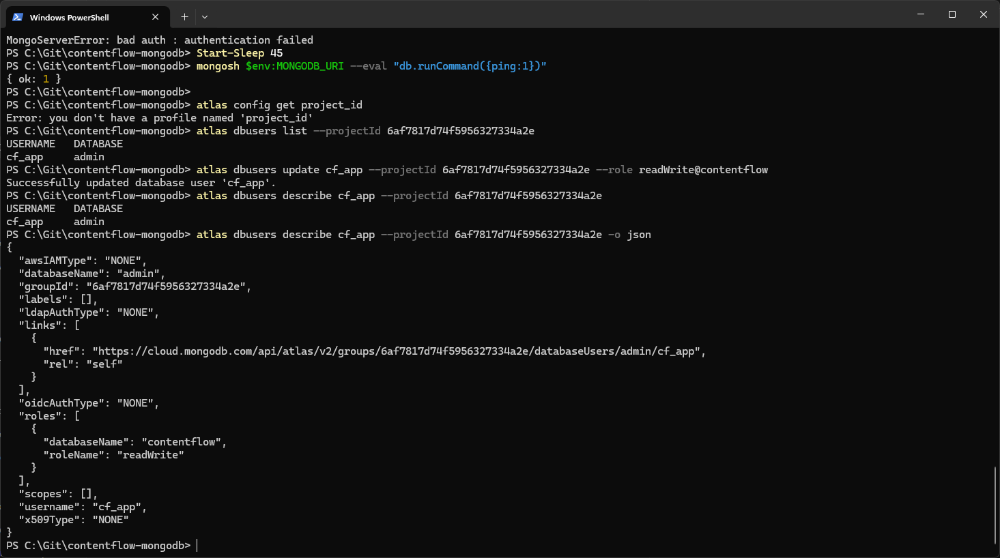

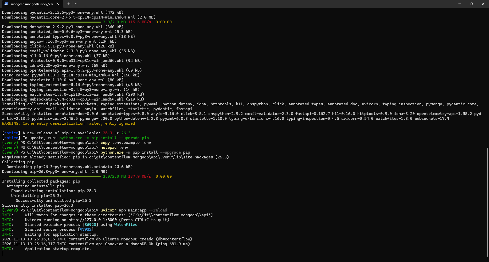

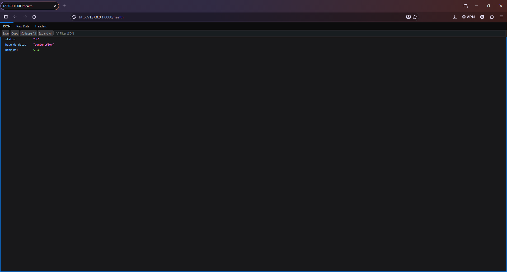

## 2.8 Problemas encontrados y soluciones

| # | Problema | Causa | Solución |
|---|---|---|---|
| 1 | La plantilla de creación ofrecía solo tiers pagados (M10 preseleccionado, US$0,12/h) | "Project 0" ya tenía un cluster Free (DUOCDB, pausado, de otro ramo) y Atlas permite solo uno por proyecto | Se creó un proyecto dedicado `ContentFlow` y se eligió el tier Free |
| 2 | Tras instalar Atlas CLI con winget, PowerShell no reconocía `atlas` | La sesión abierta no había recargado la variable PATH | Recargar PATH (`$env:Path = ...`) o abrir una terminal nueva |
| 3 | `atlas setup` no detectaba la IP pública y respondía `session expired` | Expiró la sesión de Atlas CLI; sin sesión no consulta la IP en la API de Atlas | Nuevo `atlas auth login` y `atlas setup --projectId ...`; esta vez detectó la IP y creó el cluster |
| 4 | `mongoimport` no se reconocía en PowerShell tras instalar MongoDB Database Tools con winget | El instalador no agrega `C:\Program Files\MongoDB\Tools\100\bin` al PATH | Se agregó esa carpeta al PATH de la sesión (`$env:Path += ";$bin"`) |
| 5 | `campañas.json` no se encontraba por nombre exacto al procesarlo con un script | La ñ venía codificada en Unicode NFD (archivo creado en macOS) | Se renombró a `campanas.json`, igual que la colección |
| 6 | Carpeta `__MACOSX` y archivos `._*` dentro del zip | Metadatos de macOS | Se ignoraron; no contienen datos |
| 7 | `mongoimport` y `mongosh` fallaban con `bad auth : authentication failed` | La URI tenía el marcador `<password>` sin reemplazar y, tras cambiar la contraseña, Atlas tarda unos segundos en aplicar el cambio | Se fijó la contraseña con `atlas dbusers update`, se esperó y se verificó con `db.runCommand({ping:1})` → `{ ok: 1 }` |
| 8 | En la consola, los acentos se veían mal (`Tecnolog├¡a`, `Educaci├│n`) | PowerShell 5.1 muestra la salida UTF-8 de mongosh con otra página de códigos. Los datos están bien: la consulta C3 filtra por `"Tecnología"` y devuelve resultados | `[Console]::OutputEncoding = [System.Text.Encoding]::UTF8` antes de ejecutar mongosh |

# 3. Carga e inserción de datos de prueba

## 3.1 Importación

`scripts/01_importar.ps1` ejecuta `mongoimport --jsonArray --drop` para cada colección, leyendo
la URI desde la variable de entorno `MONGODB_URI`:

```powershell
mongoimport --uri $env:MONGODB_URI --db contentflow --collection usuarios `
            --file data\usuarios.json --jsonArray --drop
```

## 3.2 Verificación de cantidades

`scripts/02_verificar_carga.js`:

| Colección | Esperado | Importado |
|---|---|---|
| usuarios | 500 | 500 |
| publicaciones | 500 | 500 |
| reacciones | 500 | 500 |
| comentarios | 500 | 500 |
| campanas | 500 | 500 |

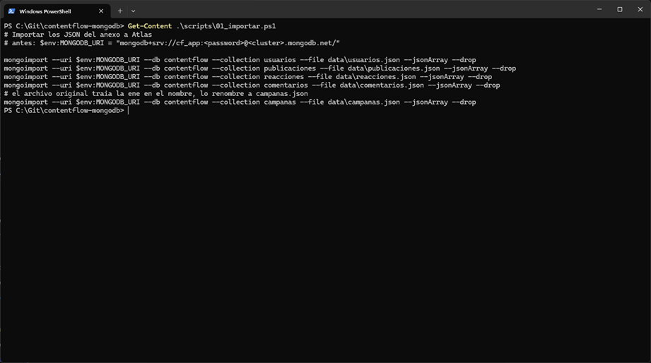

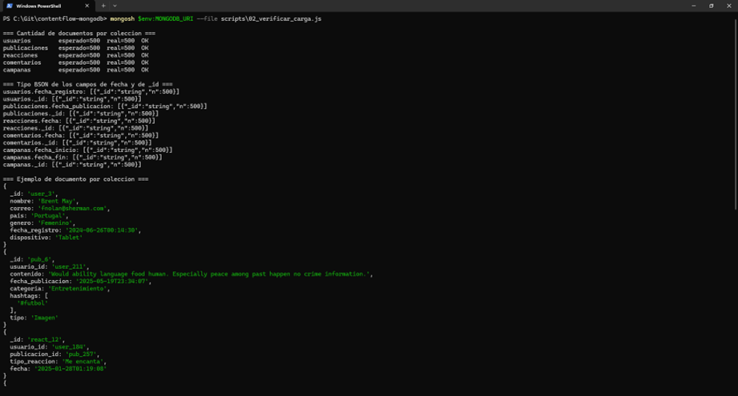

## 3.3 Conversión de fechas a `Date`

Las fechas venían como texto ISO sin zona horaria (`"2025-04-17T14:19:46"`). Sin el tipo `Date`
no funcionan `$hour`, `$dayOfWeek` ni las comparaciones de rango con `ISODate`.
`scripts/03_transformar_fechas.js` usa un `updateMany` con pipeline:

```javascript
db.publicaciones.updateMany(
  { fecha_publicacion: { $type: "string" } },               // solo las que aún son texto
  [ { $set: { fecha_publicacion: { $toDate: "$fecha_publicacion" } } } ]
);
```

- Se aplicó a 6 campos: `fecha_registro`, `fecha_publicacion`, `fecha` (reacciones y
  comentarios), `fecha_inicio` y `fecha_fin`. Se modificaron 500 documentos por campo, y la
  verificación final da 0 fechas en texto.
- El filtro `$type: "string"` hace el script **idempotente**: si se ejecuta de nuevo, no cambia
  nada.
- **Supuesto:** al no traer zona horaria, `$toDate` interpreta las fechas como UTC. Los análisis
  de horario se informan en UTC.

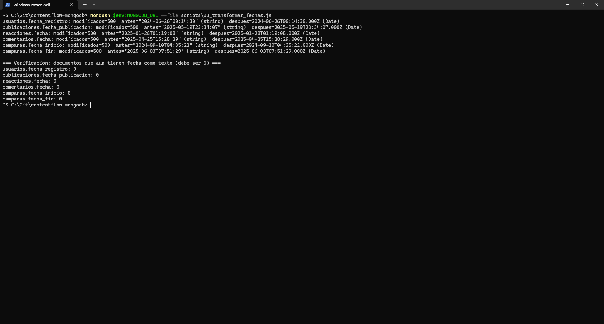

## 3.4 Inserción y verificación de documentos de prueba

`scripts/08_crud.js` inserta una usuaria, una publicación, dos comentarios y una reacción de
prueba (prefijo `test_`), y muestra cada documento antes (inexistente) y después de insertarlo.
La API también inserta documentos reales, como se ve en la sección 6.

# 4. Desarrollo de consultas

Todas las consultas están en `scripts/06_consultas.js`.

## 4.1 Consultas de lectura

| # | Requerimiento de negocio | Técnica | Resultado |
|---|---|---|---|
| C1 | Perfil de audiencia: usuarias que usan móvil | Filtro de igualdad + **proyección** + `sort` | 66 usuarias |
| C2 | Comentarios destacados | **Comparación** `$gte`/`$lte` + orden por likes | likes entre 95 y 100 |
| C3 | Diseño de contenido: videos o imágenes de Tecnología/Educación con #innovacion | **Lógicos** `$and`, `$or`, `$in` + match sobre arreglo (**búsqueda compuesta**) | Lista ordenada por fecha |
| C4 | Publicaciones de marzo 2025 que no son de texto | Rango de fechas con `ISODate` + `$nin` | 73 publicaciones |

```javascript
// C3
db.publicaciones.find({ $and: [
  { categoria: { $in: ["Tecnología", "Educación"] } },
  { $or: [{ tipo: "Video" }, { tipo: "Imagen" }] },
  { hashtags: "#innovacion" } ] }, { contenido: 0 }).sort({ fecha_publicacion: -1 })
```

## 4.2 Pipelines de agregación

| # | Requerimiento | Etapas | Hallazgo |
|---|---|---|---|
| A1 | Usuarios más activos | `$project`, `$unionWith` ×2, `$group`, `$sort`, `$limit`, `$lookup`, `$unwind` | `user_311` lidera con 10 interacciones (3 publicaciones, 6 reacciones, 1 comentario) |
| A2 | Contenidos más populares | `$lookup` ×2, `$addFields` (`$size`, `$sum`), `$sort`, `$limit` | Engagement = reacciones + comentarios + likes de comentarios |
| A3 | Diseño de contenido: categoría y tipo | `$lookup`, `$group` compuesto, `$avg`, `$round` | **Entretenimiento/Video** tiene el mayor promedio (2,57 interacciones por publicación), seguido de Tecnología/Imagen (2,31) |
| A4 | Hashtags | `$unwind`, `$lookup`, `$group`, `$sort` | `#cultura` es el más usado (221); `#aprendizaje` tiene más reacciones promedio (1,10) |
| A5 | Horarios de publicación | `$match` (excluye fechas marcadas), `$group` por `$hour` y `$dayOfWeek` | Más reacciones válidas a las 12:00 UTC; el martes es el día con más publicaciones (81) |
| A6 | Perfil de audiencia | `$lookup` usuarios, `$unwind`, `$group` (dispositivo, género), `$cond` | Móvil/Femenino es el segmento que más reacciona (73); Tablet/Femenino tiene el mayor % de reacciones positivas (58,8 %) |
| A7 | Éxito de campañas | `$unwind`, `$lookup` con `let` + `pipeline` (solo dentro de la vigencia), `$group`, `$addFields` | En promedio se cumple entre el 8 % y el 12 % de la meta de likes; solo 5 de 500 campañas la superan |

**Interpretación de A7.** Las metas (`metricas_objetivo`) van de 100 a 995 likes, pero cada
campaña tiene de 1 a 5 publicaciones con aproximadamente 1 reacción y 1 comentario cada una.
Con estos datos, casi ninguna campaña alcanza su meta. Hay dos lecturas posibles: o las metas
están sobredimensionadas, o el dataset es solo una muestra de las interacciones. La métrica
*compartidos* no se puede evaluar, porque el dataset no la registra.

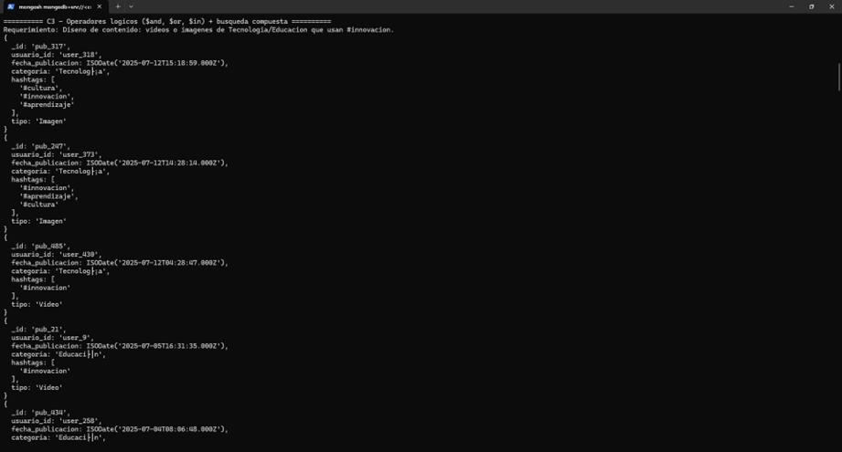

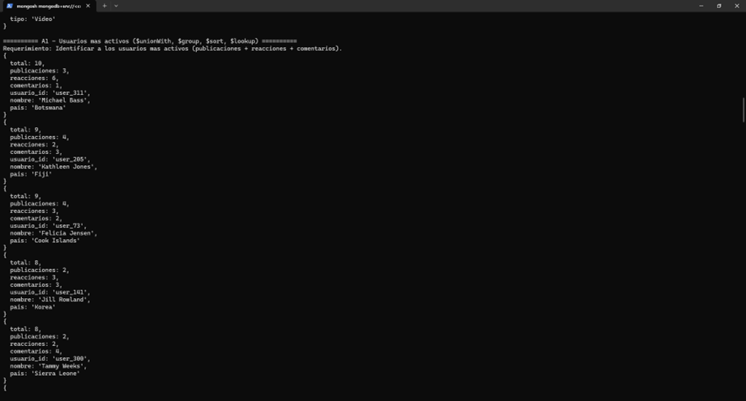

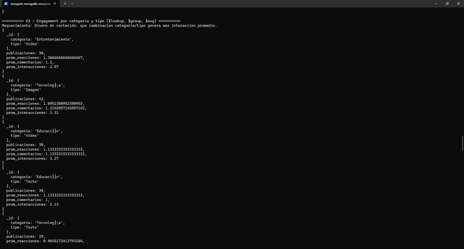

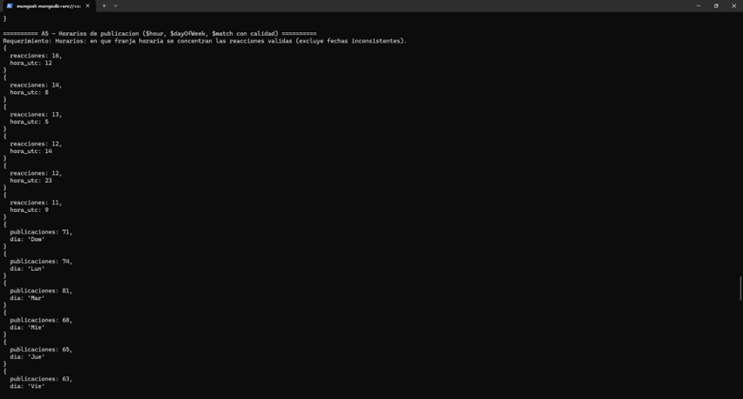

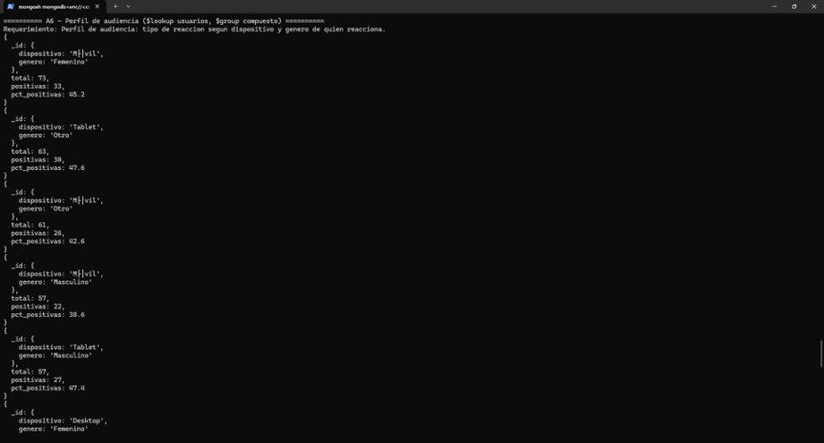

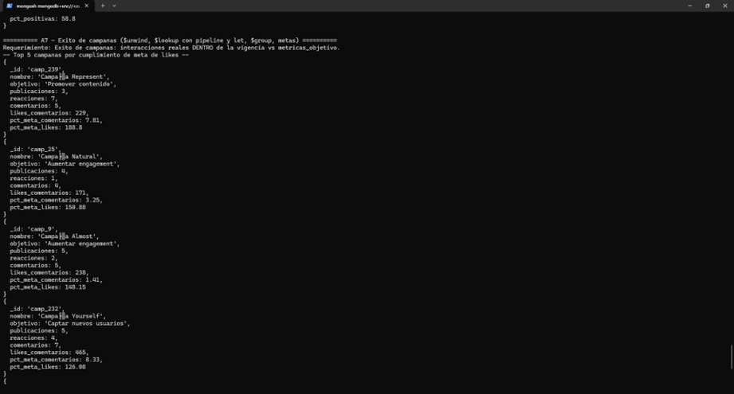

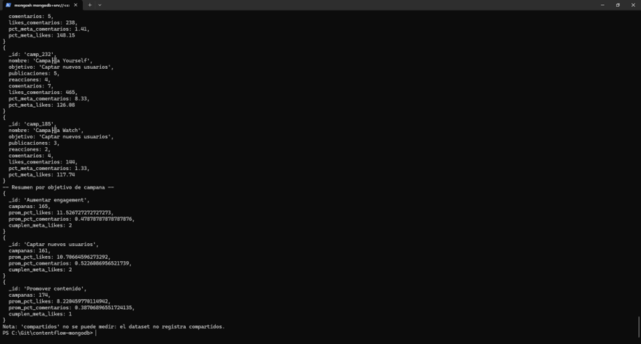

## 4.3 Evaluación de eficiencia con `explain("executionStats")`

`scripts/07_explain.js` elimina el índice correspondiente, mide la consulta, crea el índice y
vuelve a medirla.

| Consulta | Plan sin índice | Docs examinados | Plan con índice | Docs examinados | Devueltos |
|---|---|---|---|---|---|
| E1 comentarios de `pub_381` ordenados por fecha | `SORT ← COLLSCAN` | 500 | `FETCH ← IXSCAN` (`ix_pub_fecha`) | 5 | 5 |
| E2 Tecnología desde 2025-03-01, orden por fecha | `SORT ← COLLSCAN` | 500 | `FETCH ← IXSCAN` (`ix_categoria_fecha`) | 90 | 90 |
| E3 usuario por correo | `COLLSCAN` | 500 | `EXPRESS_IXSCAN` (`ux_correo`) | 1 | 1 |

Tiempo de ejecución medido en Atlas (`executionTimeMillis`): **0 ms sin índice y entre 0 y 1 ms con índice** (E1 y E2: 0→1 ms; E3: 0→0 ms en la segunda ejecución). Con 500 documentos, la diferencia está bajo la resolución de 1 ms y se ve afectada por la latencia de red y el tier compartido, así que el tiempo no es un indicador concluyente a esta escala.

**Análisis.**

- Sin índice, cada consulta recorre los 500 documentos de la colección (COLLSCAN) y, en E1 y
  E2, además ordena en memoria (etapa SORT). Con índice, la razón de documentos examinados por
  documento devuelto baja a **1:1**: se lee exactamente lo necesario.
- Con 500 documentos, el tiempo es de pocos milisegundos en ambos casos. La métrica que
  demuestra la mejora es la cantidad de documentos examinados, que crece linealmente con la
  colección sin índice y se mantiene proporcional al resultado con índice.
- En E2, el índice compuesto `{categoria, fecha_publicacion}` elimina también la etapa SORT,
  porque el orden ya viene del índice (regla ESR: igualdad, orden, rango).

**Mejoras propuestas.**

1. Índices *covered* (incluir en el índice los campos proyectados) para endpoints de listado
   que solo devuelven pocos campos, y así evitar el FETCH.
2. Precalcular contadores (`n_reacciones`, `n_comentarios`) en la publicación con `$inc` al
   insertar interacciones, para evitar `$lookup` en los rankings.
3. Guardar fechas con zona horaria explícita o la zona del usuario, para analizar horarios
   locales.
4. Revisar periódicamente en Atlas el *Performance Advisor* (en tiers superiores) y los planes
   de las consultas lentas.

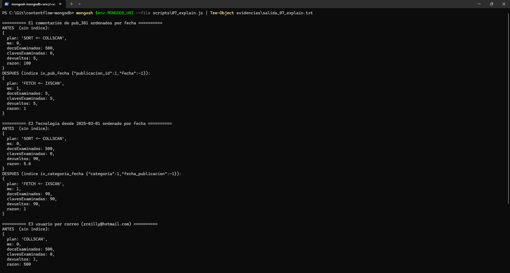

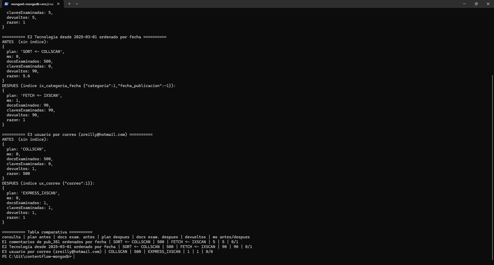

# 5. Operaciones CRUD y calidad de datos

## 5.1 CRUD con casos de negocio (`scripts/08_crud.js`)

| Paso | Operación | Caso de negocio | Evidencia |
|---|---|---|---|
| C1 | `insertOne` | Se registra una nueva usuaria | antes: no existe / después: documento |
| C2 | `insertOne` + validación de referencia | La usuaria publica (se verifica que exista) | documento creado |
| C3 | `insertMany` | Llegan 2 comentarios y 1 reacción | 0 → 2 comentarios |
| R1 | `aggregate` + `$lookup` | Ver la publicación con sus interacciones | n_comentarios = 2, n_reacciones = 1 |
| U1 | `$set` | La autora corrige contenido y categoría | campo `editado` agregado |
| U2 | `$inc` | Un comentario recibe 3 likes | likes 0 → 3 |
| U3 | `$push` + `$each` | Se agregan hashtags | 1 → 3 hashtags |
| U4 | `$addToSet` | Se asocia la publicación a `camp_1` (ejecutado 2 veces, no duplica) | aparece una sola vez |
| U5 | `updateOne` por filtro compuesto | El usuario cambia su reacción | "Me encanta" → "Me gusta" |
| V1 | insert duplicado | Segunda reacción del mismo usuario | **rechazado, E11000** (índice único) |
| V2 | insert duplicado | Correo ya registrado | **rechazado, E11000** |
| V3 | validación previa | Comentario a `pub_99999` | rechazado, la referencia no existe |
| D1 | `deleteOne` | El usuario quita su reacción | documento eliminado |
| D2 | `deleteMany` + `$pull` | Borrado en cascada de la publicación | pub 1 → 0, comentarios 2 → 0, en camp_1 1 → 0 |
| D3 | `deleteMany` | Baja de la usuaria de prueba | conteos finales iguales a los iniciales (reacciones = 499, porque el duplicado se movió a `reacciones_descartadas`) |

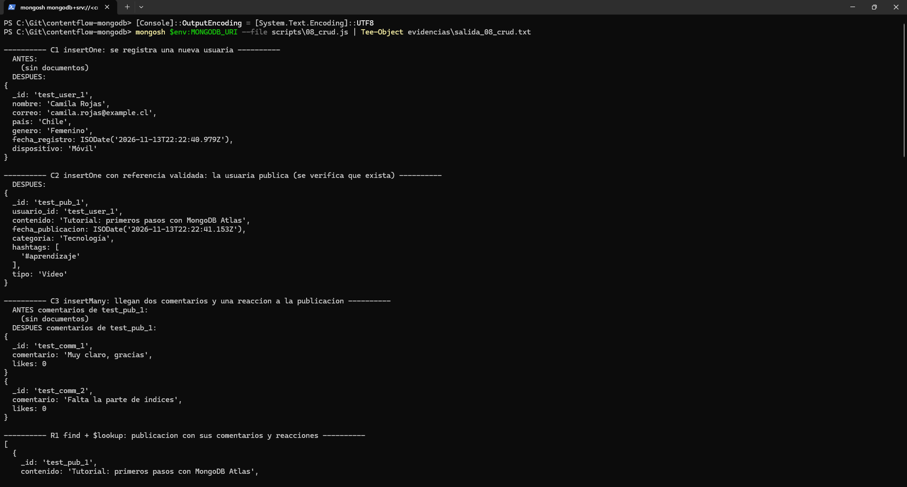

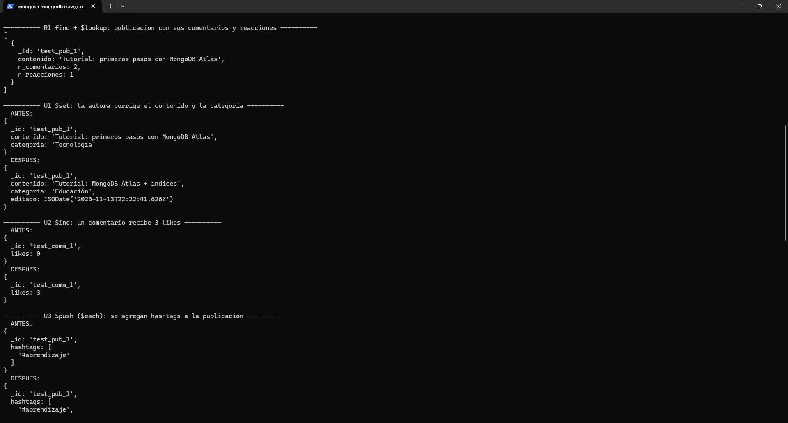

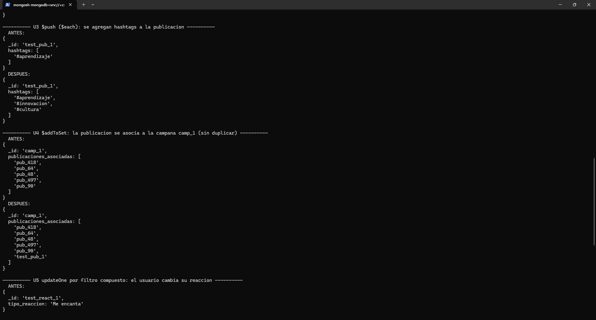

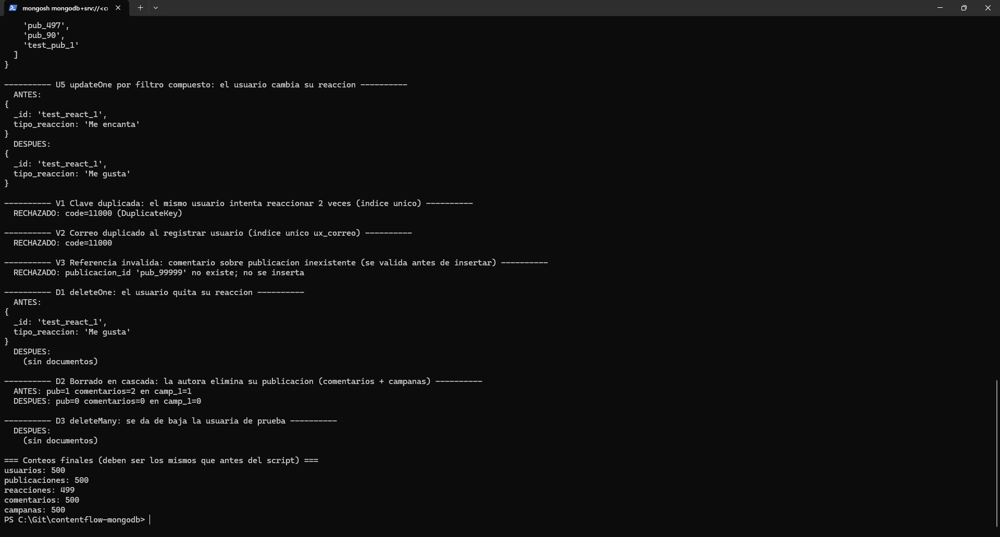

## 5.2 Inconsistencias detectadas y criterio aplicado (`scripts/04_inconsistencias.js`)

Cada hallazgo queda registrado en la colección **`auditoria_calidad`** (regla, cantidad, ids de
muestra, acción y fecha). Así ningún dato se pierde sin evidencia.

| Hallazgo | Casos | Criterio y acción |
|---|---|---|
| `_id` duplicados (5 colecciones) | 0 | Sin acción |
| Correos duplicados | 0 | Se crea índice único para prevenirlos |
| Referencias inválidas (`usuario_id`, `publicacion_id`, publicaciones de campañas) | 0 | Sin acción; la API valida referencias antes de escribir |
| Reacción anterior a la fecha de la publicación | 245 (244 tras retirar el duplicado `react_140`, que también estaba marcado) | **Marcar** `calidad.flags`; excluir de análisis temporales y de campañas |
| Comentario anterior a la fecha de la publicación | 251 | Igual que el anterior |
| Publicación anterior al registro de su autor | 48 | Marcar |
| Reacción o comentario anterior al registro del usuario | 53 / 54 | Marcar |
| Publicaciones de campañas fuera de la vigencia | 449 asociaciones en 272 campañas | Marcar en `calidad.publicaciones_fuera_de_rango`; el reporte de éxito cuenta solo interacciones dentro de la vigencia |
| Reacción duplicada (`user_473` sobre `pub_425`: `react_65` y `react_140`) | 1 | **Mover** la más antigua a `reacciones_descartadas` con el motivo, conservar la más reciente y crear índice único |
| Nombres de campaña repetidos | 91 nombres (199 campañas) | Se conservan: tienen `_id` y objetivos distintos; la clave es `_id` |
| Usuarios homónimos | 4 pares | Se conservan: correos distintos indican personas distintas |
| Autointeracción (reaccionar o comentar lo propio) | 1 + 1 | Se marca e informa; es válido en la plataforma |

**Por qué marcar y no corregir ni borrar.** Corregir una fecha (por ejemplo, igualarla a la de la
publicación) sería inventar datos. Borrar los registros eliminaría cerca de la mitad de las
interacciones y sesgaría los análisis. Marcarlos permite excluirlos donde importa la fecha
(horarios, campañas) y usarlos donde no importa (conteos de actividad), y deja la decisión final
documentada para el negocio.

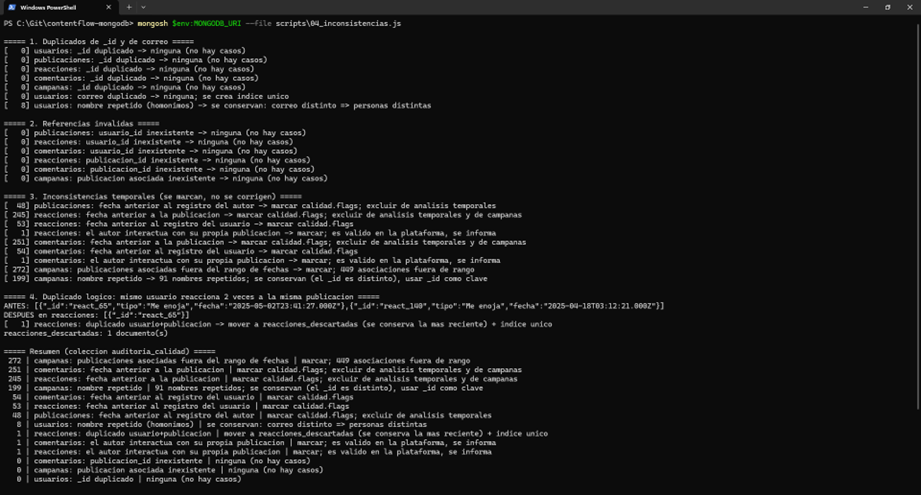

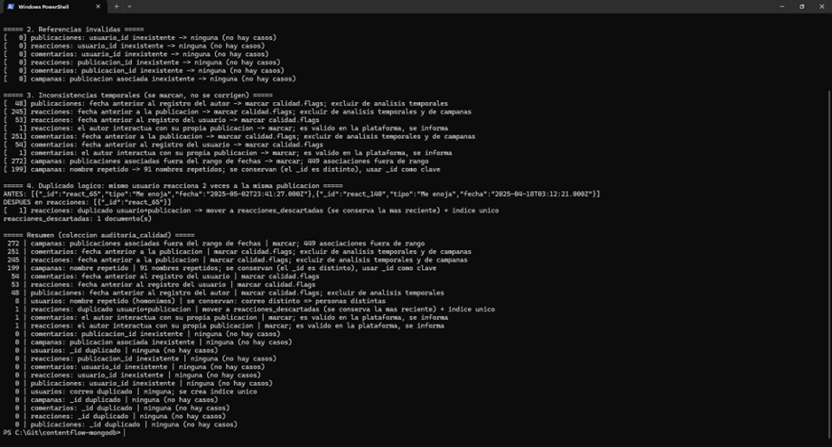

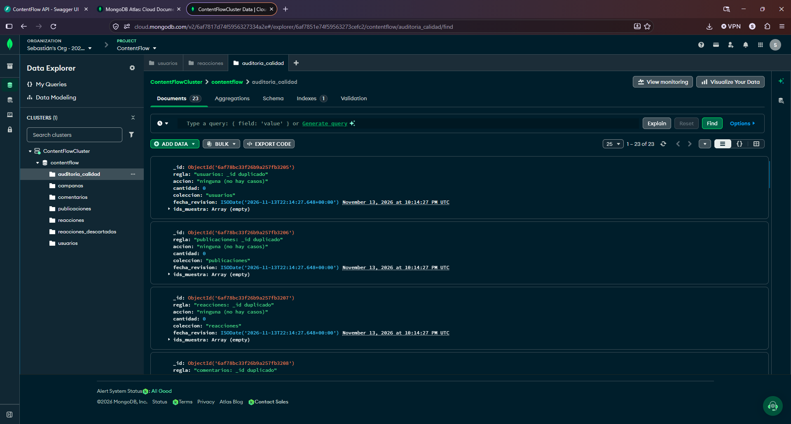

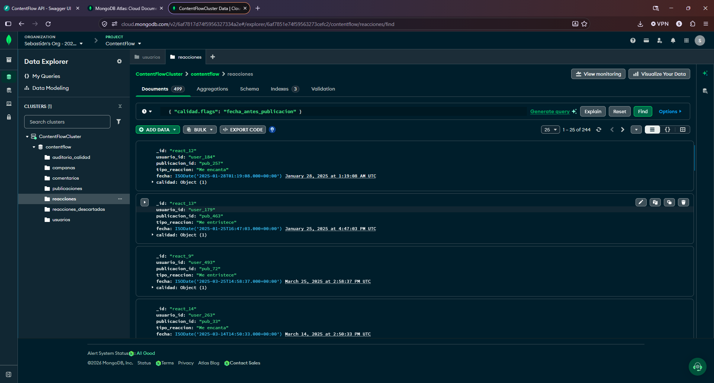

# 6. Integración con aplicación externa (API REST)

## 6.1 Tecnologías

| Librería | Uso |
|---|---|
| FastAPI | Framework REST; genera documentación en `/docs` |
| pymongo | Driver oficial de MongoDB |
| Pydantic (+ email-validator) | Validación de entradas |
| python-dotenv | Carga de variables de entorno desde `.env` |
| uvicorn | Servidor ASGI |

## 6.2 Flujo de integración

```
Cliente (Swagger UI / Postman) --HTTP/JSON--> FastAPI
   1. middleware: asigna request_id y registra la petición en el log
   2. Pydantic valida el cuerpo (si falla: 422)
   3. se validan las referencias en MongoDB (si falla: 422 referencia_invalida)
   4. pymongo ejecuta la operación en Atlas (w: majority, readConcern: majority)
   5. respuesta JSON; si hay excepción, el manejador la traduce a 404/409/503/500
```

## 6.3 Manejo del string de conexión

- El string de conexión se lee de la variable de entorno **`MONGODB_URI`** (`app/config.py`),
  que se carga desde un archivo `.env` local.
- `.env` está en `.gitignore`. El repositorio solo incluye **`.env.example`**, con valores de
  ejemplo y sin credenciales.
- Si falta la variable, la API no arranca y muestra un mensaje claro.

## 6.4 Endpoints (lectura y escritura sobre las 5 colecciones)

Ver la tabla del `README.md`: 20 rutas, con GET, POST, PATCH y DELETE sobre `usuarios`,
`publicaciones`, `comentarios` y `reacciones`, y reportes de lectura que incluyen `campanas`.

## 6.5 Evidencia en tiempo real

Las pruebas en vivo contra Atlas se hicieron con **Swagger UI** (`/docs`), el cliente API que
genera FastAPI y que el enunciado admite como equivalente a Postman. Se creó un usuario (201) y
el documento apareció de inmediato en Atlas Data Explorer. Al repetir la petición, el índice
único devolvió 409. Además, la colección exportada `postman/ContentFlow.postman_collection.json` se ejecutó completa
contra Atlas con **newman** (el ejecutor de colecciones de Postman por línea de comandos):
**24 requests y 29 aserciones, 0 fallidas**, con un tiempo de respuesta promedio de 123 ms. La
corrida crea, lee, actualiza y elimina en usuarios, publicaciones, comentarios y reacciones, y
verifica los errores 404, 409 y 422.

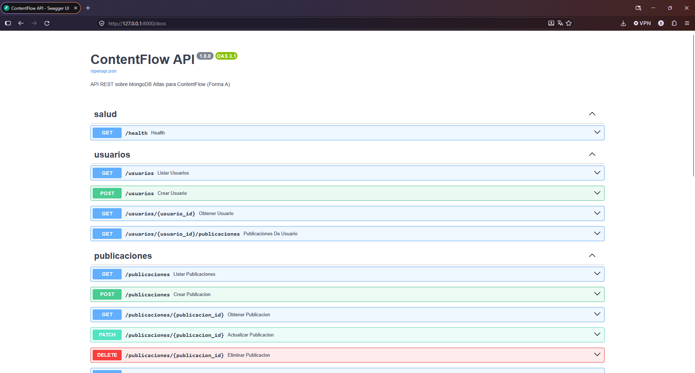

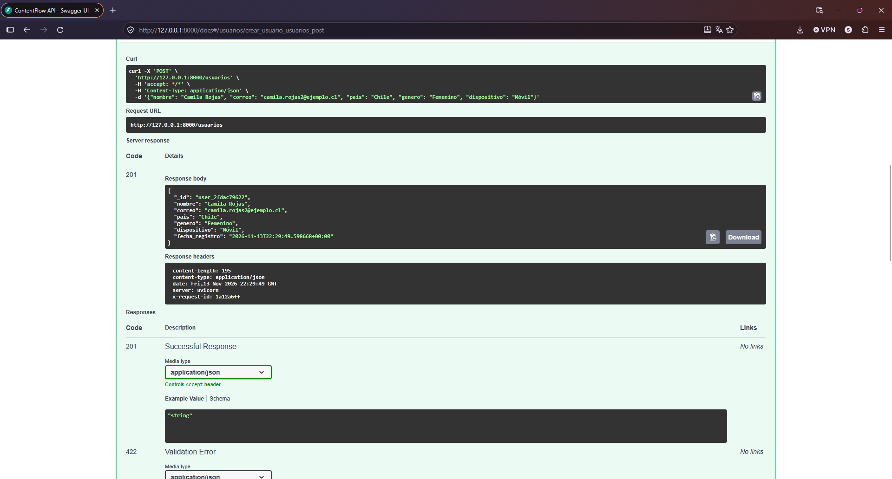

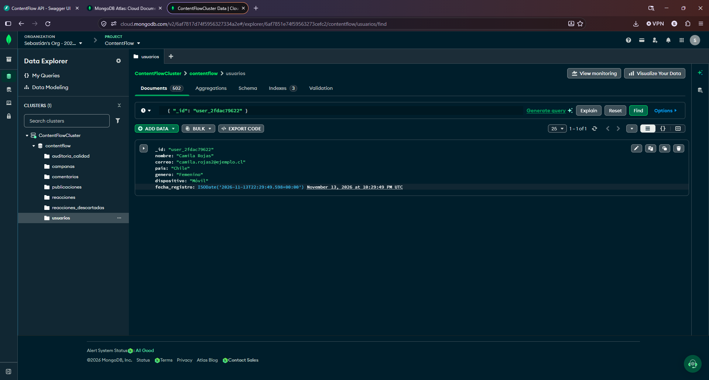

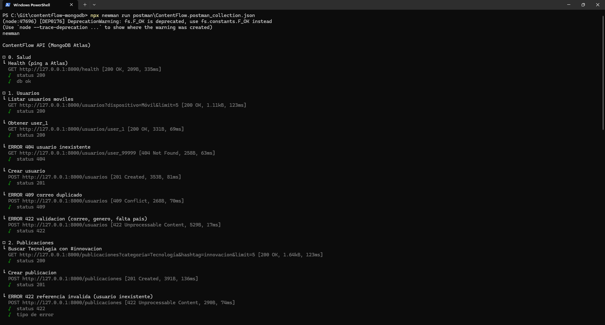

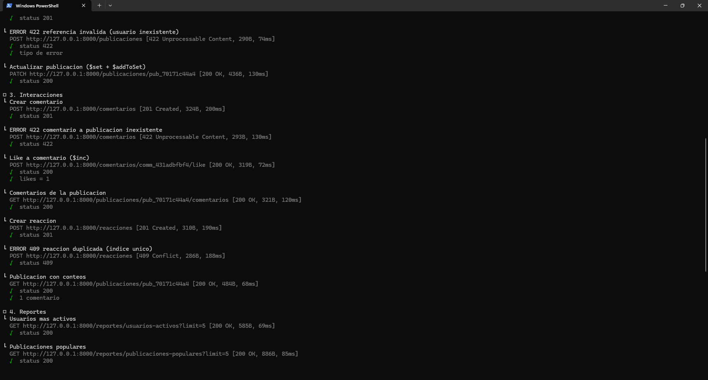

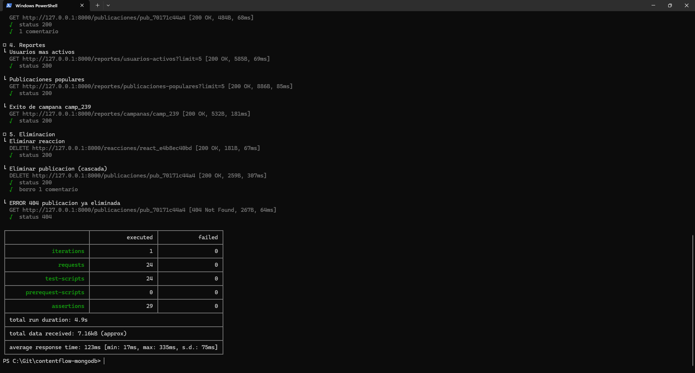

# 7. Control de errores y validaciones

| Mecanismo | Implementación | Ejemplo |
|---|---|---|
| Campos obligatorios y tipos | Modelos Pydantic con `extra="forbid"`, largos mínimos y máximos | `POST /usuarios {"nombre": "A"}` → 422 con la lista de campos faltantes |
| Valores permitidos | `Literal` para género, dispositivo, categoría, tipo y tipo de reacción; patrón regex para hashtags; `EmailStr` para correo | `genero: "Robot"` → 422 |
| Referencias existentes | `exigir_referencia()` antes de insertar | `publicacion_id: "pub_99999"` → 422 `referencia_invalida` |
| Clave duplicada | Índices únicos + manejador de `DuplicateKeyError` | correo repetido o segunda reacción → **409** |
| Documento inexistente | Excepción `NoEncontrado` | `GET /usuarios/user_99999` → **404** |
| Error de conexión | Manejador de `ServerSelectionTimeoutError`, `ConnectionFailure`, `AutoReconnect` y `NetworkTimeout`, con timeout de 5 s | Atlas inaccesible → **503** `base_de_datos_no_disponible` |
| Error no controlado | Manejador genérico | **500** con `request_id` para rastrearlo |
| Logs de actividad | Middleware: `rid`, método, ruta, estado y duración; archivo rotativo `logs/api.log` (1 MB × 3) | `rid=9328a26f GET /publicaciones/pub_x -> 404 (1.6 ms)` |
| Trazabilidad | Cada respuesta lleva el encabezado `X-Request-ID`, y los errores incluyen `request_id` en el JSON | Se cruza la respuesta con la línea exacta del log |
| Prueba de conectividad | `ping` al iniciar (queda en el log) y endpoint `GET /health` | 200 `{"status": "ok", "ping_ms": ...}` o 503 |

Formato uniforme de error:

```json
{"error": "clave_duplicada", "detalle": {"clave": {"correo": "..."}}, "request_id": "a1b2c3d4"}
```

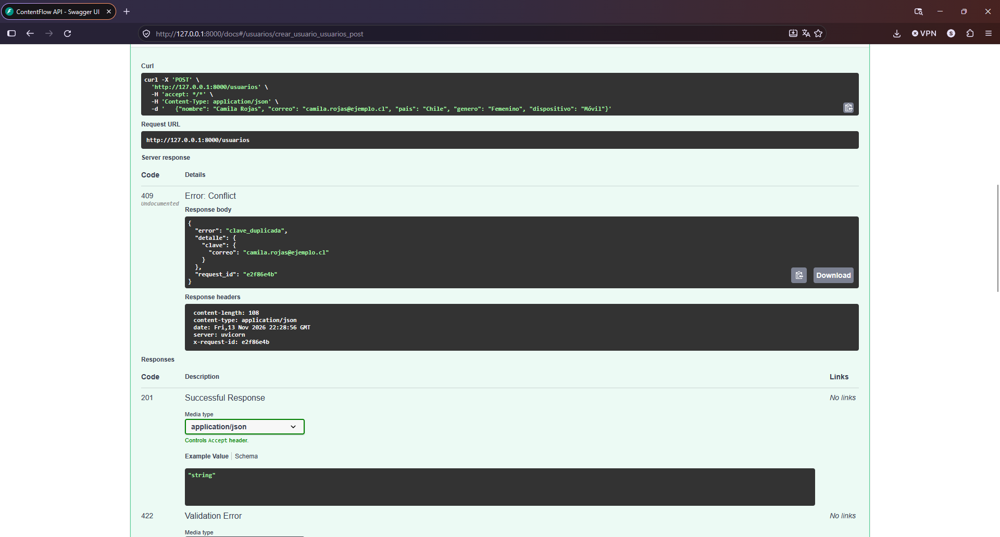

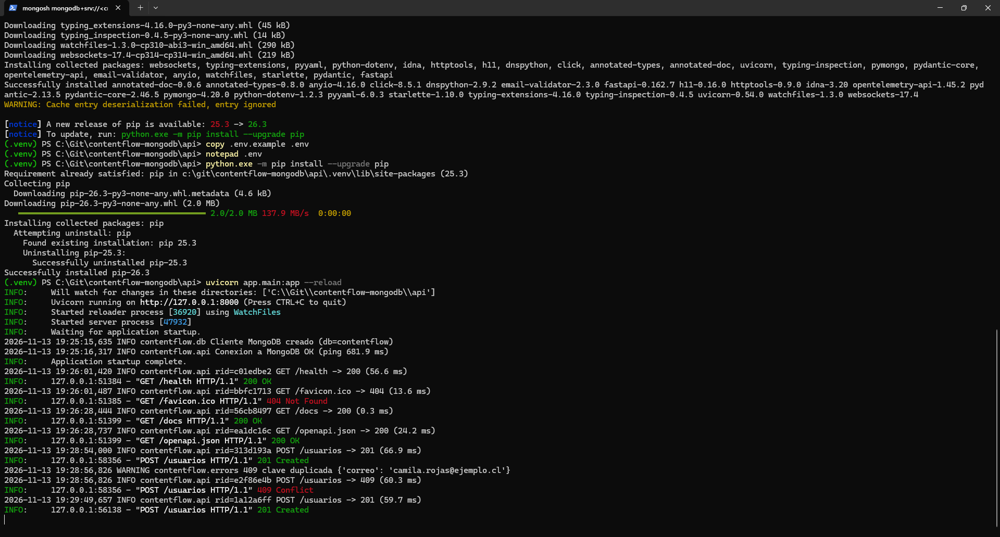

# 8. Conclusiones

- MongoDB Atlas M0 es suficiente para el volumen del caso (2.500 documentos). Sus límites
  (100 operaciones/s, 0,5 GB, sin sharding) obligan a diseñar con índices y paginación desde
  el inicio.
- Convertir las fechas a `Date` fue requisito para responder las preguntas de horarios y
  campañas.
- El dataset no tenía errores de integridad referencial, pero sí inconsistencias temporales en
  cerca de la mitad de las interacciones. Marcarlas en vez de borrarlas preservó la información
  y dejó trazabilidad en `auditoria_calidad`.
- Los índices redujeron los documentos examinados de 500 a exactamente los devueltos.
- La API valida en dos capas (esquema y referencias), traduce cada falla a un código HTTP
  preciso y registra cada petición con un identificador rastreable.

**Fuentes**

- MongoDB, *Atlas Free Cluster Limits*: https://www.mongodb.com/docs/atlas/reference/free-shared-limitations/
- MongoDB, *Unsupported Commands in Atlas*: https://www.mongodb.com/docs/atlas/unsupported-commands/
